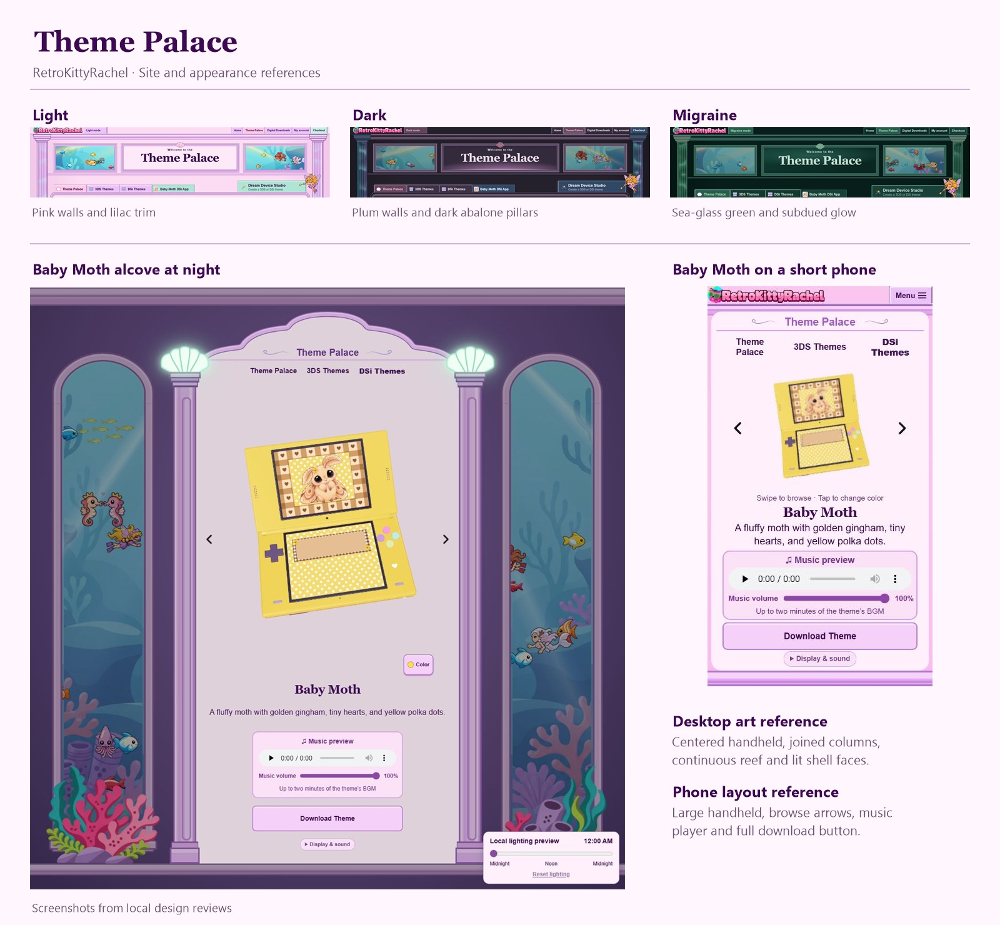
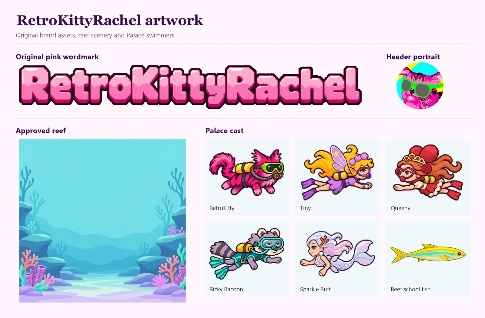

# RetroKittyRachel creative brief
Theme Palace, site branding, and Dream Device Studio
Source snapshot from November 21, 2026

This is the creative reference for RetroKittyRachel’s website and 3DS and DSi theme tools. The companion images contain site screenshots and original artwork. The screenshots are development and art review references. They show visual direction and may contain older interface details. The written brief reflects the selected main-branch snapshot.

## Theme palace

Build around a pastel underwater palace with the feel of a retro game. The visitor should notice the handheld and its theme artwork first. The architecture, reef, and swimmers provide the setting. Baby Moth’s nighttime alcove is the reference for the balance between the device, the two windows, and the shell lamps.

Keep the architecture smooth and connected. The arches, pillars, shell lamps, molding, and sills should meet cleanly. Preserve the gallery columns’ original stepped capitals and proportions. Keep the small center shell’s five lobes, interior ribs, original bounds, and pink and purple colors. Display it at 40 px on desktop and 32 px on mobile.

Use these established Palace colors by role.

- **Daytime walls and panel** — #FAC5EE blush and #FFF0FB pale pink
- **Arch and window trim** — #9A60BA outline, #ECC3F7 lilac, #FBE4FF highlight
- **Water, shell, and lamp glow** — #8CDEE2 aqua, #AEE5D5 seafoam, #EFFFF3 mint-white
- **Night walls** — #64527F dusty violet through #34274A deep plum
- **Main text** — #3D0953 deep plum
- **Star wand** — #F6BD4E honey gold and #FFE5A1 pale gold

The approved reef has open aqua water in the middle, rounded dark-blue shelves and branching seaweed at the sides, and a lavender seabed that recedes into the distance. Use candy-pink and lilac coral, lavender rocks, teal or seafoam leaves, and small lime accents. Keep contours rounded, shading simple, and coral rooted to the seabed. In the gallery and alcoves, the two openings reveal one continuous room-scale view. Let the architecture mask the scene between openings. Keep moving characters, sun and moon beams, and lighting separate from the static reef. Preserve Rachel’s refined window artwork and the architecture outlines unless she approves a specific change. Earlier blocky plants, copied coral arrangements, and photorealistic treatments were rejected.

At night, the shell face and its outlines brighten first. A soft glow spreads from the shell’s silhouette with no visible rectangular edge. The small center shell glows warm peach-gold and the alcove lamps glow mint-white. In daylight the lamps use their base colors with the glow off. Darken the water at night while keeping the cast readable. The Palace’s local day/night cycle is distinct from the visitor’s Appearance choice.

## Characters and motion

Use the approved Ricky Racoon, Tiny, Queeny, RetroKitty, and reef school artwork as the model sheet. Match the outer outline weight against the visible sprite, the signature colors and shapes, and the legibility of eyes, faces, fins, and markings at actual swimming size. Use up to three flat colors per material, with a base, a shadow, and a highlight. Keep the shapes simple and use saturated candy colors that read against the water in both lighting states. Keep full-resolution transparent originals. The approved pixel wordmark is a separate visual treatment from the smooth cartoon scenery and swimmers.

Fish travel nose-first with quick tail flicks and a small bob. The school scatters on click and eases back into formation. Sparkle Butt glides with arm strokes and a kicking tail, with hair trailing. Tiny and Queeny bob and wiggle. RetroKitty paddles, winks, and glints her goggles with a meow. Ricky cruises with alternating kicks, with distinct cookie-bite and yawn poses. Squish rises with trailing tentacles and releases a separate drifting purple ink cloud. The turtles and seahorses have paired motion. The pufferfish briefly inflates on click. The pink dolphin passes close to the glass with two tail beats and a glide, once at the top of the hour.

Keep motion inside the windows so swimmers can disappear behind the wall and reappear naturally. Idle motion stays gentler than click reactions. Ambient and reaction bubbles share the same smooth turquoise shape, teal outline, lighter aqua face, and small white glint. The cursor uses a single gold star wand with a moving sparkle trail. Honor reduced motion and the Palace animation controls, including for pillar reflections and decorative stars. Music starts paused. Character voices, reaction sounds, and the download chime follow the separate Sound setting.

## Branding and page design

Use Rachel’s original transparent pink RetroKittyRachel wordmark as one piece of artwork. Preserve its blocky pixel edges, letterforms, spacing, white highlights, pink shading, dark outline, and aspect ratio. The circular RetroKitty portrait is a separate asset and slightly overlaps the first letter in the shared header. Match the backdrop behind the logo and tabs to the page’s base color, including the Palace wall color as lighting changes. Keep the purple rule and touching tab shapes. In Light mode, pink marks the current page and seafoam identifies Checkout.

The desktop gallery frames the center title plaque with two aquarium windows and stepped outer columns. Keep the 3DS and DSi collections visually distinct. In Light mode the active collection tab is pink, the other collection tabs are beveled lilac, and the Baby Moth DSi App tab is square-cornered seafoam. In portrait phone layouts, use a compact title and text navigation, one centered gallery card per view, and a translucent next arrow at the right edge of its artwork. Keep device artwork visible during 3D loading or when 3D is unavailable. Preserve the user-selected shell color for the matching gallery card.

On a desktop theme detail page, center the arch and its two windows as a group. The wide-screen group is capped at 1,440 CSS px and 1.45 times the viewport height. Leave the extra space as plain Palace wall, and retain the proportions of the central arch. On a portrait phone, use the daytime pink backdrop, make the device large, and keep both arrows, music player and volume, and the full Download Theme button above the fold. On 3DS phones, place the bright pink QR button before Download. Keep controls legible, keyboard focus visible, and the layout usable at narrow widths and with zoom. Add visible UI only when Rachel asks for it.

## Appearance modes

Light is the default. Use the original pastel pink and lilac Palace finish, with no added gallery frame glow.

Dark retains the plum Dim palette. Reference colors include #25212C base, #332A3B raised surface, #393041 card, #E5DCE8 text, and #E8B6D0 accent. The gallery pillars have a dark abalone finish with ink-teal shafts, violet ridges, and seafoam reflections. The title plaque has a steady lavender glow at its lower edge, with quieter accents on frames, active tabs, and controls. Dark’s Dream Device Studio, Checkout, and Baby Moth actions use deep sea-glass blue with a frosted aqua edge and pale lettering. Rachel rejected the navy Dark concept with coral selection, mint actions, and amber keyboard focus.

Migraine uses subdued sea-glass green pillars and glow. Reference colors include #071E1B base, #0B2B27 raised surface, #123630 card, #C8DED2 text, and #A8D9BF accent. Display handheld previews at 62% brightness. The dimming applies to the viewing experience. Source artwork, QR codes, and theme exports retain their colors.

## Dream device studio

The 3DS and DSi editors share a visual system. Keep the large handheld fixed and centered on desktop, its toolbar above it, the sticker strip below it, and Tiny with her wand beside it. The right inspector scrolls independently and Export stays visible above it. Keep the title area compact, with Sparkle Butt above the title. Use compact, flat Palace-color controls and readable full-width screen section headings. Keep the two editors coherent when changing shared controls.

Light uses a soft pastel sky with cloudlike highlights and pink screen heading bars. Dark uses a violet, pink, and blue galaxy with brighter stars, pale control text, deep violet tool faces, magenta selection, deep blue Advanced and Export buttons, and dark pinkish-purple screen heading bars. Migraine uses muted sea-glass colors and dims the Studio view, including Tiny and the uploaded artwork. A new design defaults to a black shell in Dark and dark plum in Migraine. A manually chosen or saved shell color carries through appearance changes.

## How to review new art

Treat the attached originals and Rachel’s approvals as the visual baseline. For an image prompt, specify the reference’s role, the feature to change, and the details to preserve. Keep new asset cutouts transparent where appropriate and compare them with the existing art at scene size. For any proposed Palace art change, show the existing and proposed versions side by side at actual display size. Use a still for shape, color, or placement and a short loop for motion. Show day and night when lighting matters. Identify what changed and wait for Rachel’s approval before applying it to the Palace. Treat any new direction as a proposal until she approves it.

## Source and companion images

This brief was distilled from the local RetroKittyRachel site main branch at d1f2bf8. The primary source files were docs/palace-art-direction.md and docs/project-handoff.md. Appearance swatches were cross-checked against the site CSS. The source snapshot describes the Next.js site and development editors. The live WordPress deployment is managed separately. Rachel has since scrapped the Study Room for now.

